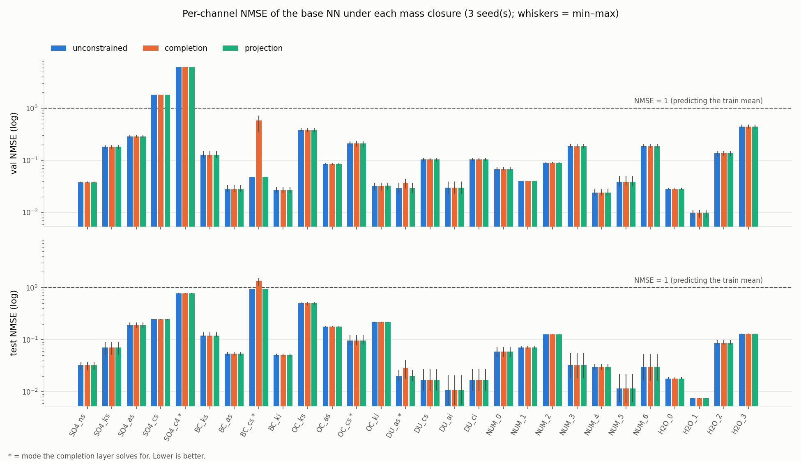

# Hard mass conservation in the M7 aerosol emulator: projection is free, completion is a trap

A reproduction and follow-up of [Harder et al. (2022), *Physics-Informed Learning of Aerosol
Microphysics*](https://arxiv.org/abs/2207.11786), using their public dataset and model.

**Result.** The emulator's outputs should conserve mass within each aerosol species. Enforcing that
by **orthogonal projection** of the network's output gives exact conservation (residual ~1e-13) with
**no measurable loss in accuracy** (3 seeds). Enforcing it by **completion**, which solves for one designated mode
from the others (the `--model completion` option in the public repo), pushes all the accumulated error
into that one mode and **degrades the `BC_cs` channel on every seed**, pushing it below a
mean-predictor on the test split.

## Main result

Base NN from the paper, retrained with 3 seeds on the full data. The closure is applied to the
network's output after training.

Mean over 3 seed(s); range in parentheses.

| split | closure | mean R² | median R² | mean NMSE | BC_cs R² | BC_cs NMSE | max rel. mass residual |
|---|---|---|---|---|---|---|---|
| val | unconstrained | 0.7972 (0.7970–0.7976) | 0.8813 (0.8770–0.8885) | 0.3878 (0.3859–0.3905) | 0.006 (-0.002–0.011) | 0.048 (0.047–0.048) | 2.5e+02 (1.1e+02–4.8e+02) |
| val | completion | 0.3996 (0.2952–0.5794) | 0.8813 (0.8770–0.8885) | 0.4078 (0.3969–0.4158) | -11.109 (-14.006–-6.107) | 0.581 (0.341–0.720) | 8.7e-14 (7.6e-14–9.7e-14) |
| val | projection | 0.7972 (0.7970–0.7976) | 0.8814 (0.8770–0.8886) | 0.3878 (0.3859–0.3905) | 0.006 (-0.002–0.011) | 0.048 (0.047–0.048) | 2.1e-13 (1.8e-13–2.6e-13) |
| test | unconstrained | 0.7864 (0.7746–0.8019) | 0.8791 (0.8590–0.8947) | 0.1477 (0.1409–0.1529) | -0.000 (-0.000–0.000) | 0.944 (0.944–0.944) | 9.0e+01 (6.0e+01–1.3e+02) |
| test | completion | 0.7691 (0.7523–0.7976) | 0.8775 (0.8590–0.8947) | 0.1624 (0.1450–0.1737) | -0.425 (-0.614–-0.125) | 1.345 (1.061–1.523) | 1.3e-13 (1.3e-13–1.4e-13) |
| test | projection | 0.7864 (0.7746–0.8019) | 0.8791 (0.8590–0.8947) | 0.1477 (0.1409–0.1529) | -0.000 (-0.000–0.000) | 0.944 (0.944–0.944) | 2.8e-13 (2.0e-13–3.6e-13) |

- **Projection costs nothing.** On every seed and split, R² agrees with the unconstrained model to 4
  decimals and no channel's NMSE changes by more than 0.003. Conservation improves from a relative
  residual of 60–480 to ~1e-13.
- **Completion damages `BC_cs` on every seed.** NMSE rises ~12× on val (0.048 → 0.58). On test it goes
  from 0.94 to 1.35, which is worse than predicting the training mean. The other channels barely move,
  so mean NMSE only rises 5–10%. The damage is concentrated in the one mode that absorbs the error.
- **R² exaggerates the drop.** The headline val R² for `BC_cs` (≈ −11) is inflated by that channel's
  small val variance (see caveats). NMSE is the fairer measure, and it still shows completion clearly losing.



NMSE_j = mean((ŷ_j − y_j)²) / var(y_train_j). Unlike R², this is normalized by the *train* variance,
so it does not swing with the evaluation split's own variance (see caveats).

## Why it happens

Mass conservation says the tendencies of one species' modes sum to zero. For `BC_cs`, the true value is
a small leftover after much larger sibling modes nearly cancel: it is about **2400× smaller** than the
sum of its siblings' magnitudes. To get `BC_cs` to 10% relative accuracy by completion, the siblings
would have to be accurate to about 0.004%. Completion inherits every sibling error, amplified by that
ratio.

Projection instead spreads the correction over all modes of a species, weighted by each mode's training
variance (the minimum-norm fix in the normalized space the network is trained in). The correction is
tiny relative to each mode's scale, so accuracy is unchanged.

Neither closure makes `BC_cs` (or `SO4_c4`, another cancellation residual) *learnable*: per-channel
R² stays ≈ 0 for every model tried, and test NMSE for `BC_cs` is 0.94. That is a conditioning limit, not a capacity limit. **The constraint buys
conservation, not accuracy.**

## Caveats worth knowing about this dataset

- **The splits are not iid.** Per-channel variance differs between val and test by up to 20× (ratio
  0.05 for `BC_cs` to 7.6 for `SO4_c4`), probably because the split is by time or region. R², which
  normalizes by the evaluation split's own variance, swings a lot as a result. Report median and
  per-channel scores, not only the mean.
- **Validation can give zero warning.** Feeding a quadratic model's predictions to the NN as extra
  features matched the control on val (R² 0.789 vs 0.797) but collapsed on test (0.392 vs 0.775). The
  damage landed exactly on the channels where the quadratic model fails under the shift (`nn_poly2.py`).
- **`Mass RMSE` understates violation by about 5 orders of magnitude.** It normalizes by species-mean input
  magnitude (3.7e-4 for the unconstrained NN). The relative residual |Σ modes| / mean|modes| for the
  same predictions is 60–130 on test and 110–480 on val across seeds.
- **Linear models conserve mass automatically.** OLS with an intercept inherits any exact linear
  conservation law of the targets (Ŷ = HY, and the constant vector is in the design's column space).
  The unconstrained linear fit conserves to 6.5e-12, so closure layers only matter for nonlinear models.

## Reproduction and baselines

All scored with one harness that matches the original repo's `utils.get_scores` to ~1e-15
(mean R² over 28 outputs).

| model | val R² | test R² |
|---|---|---|
| linear (32 z-scored features) | 0.248 | 0.210 |
| linear on log features | 0.075 | 0.034 |
| quadratic (561 features) | 0.596 | 0.254 |
| **base NN, 100 epochs (paper settings), seed 0** | **0.797** | **0.775** |
| base NN, mean of 3 seeds (range) | 0.797 | 0.786 (0.775–0.802) |
| NN + quadratic features (concat) | 0.789 | 0.392 |
| NN + quadratic (residual) | 0.744 | 0.380 |

The paper reports test R² 0.763 and Mass RMSE 3.7e-4; this run gets 0.775 and 3.74e-4. The NN
beats the quadratic model on all 28 channels. The stacking rows are single-seed (seed 0).

## Reproduce

```sh
pip install -r requirements.txt
sh scripts/run_all.sh        # downloads the data (~4.6 GB) and runs everything, one job at a time
```

Each NN run takes ~35 min on an M1 CPU and holds ~1.4 GB of training data in memory. The scripts run
sequentially, so 8 GB of RAM is enough. Trained checkpoints (~100 KB each) are in `results/`, so
`nn_closure.py --ckpt results/nn_base.pth` reproduces the main result without retraining.

| file | what it does |
|---|---|
| `linear_baseline.py` | linear / log / quadratic baselines, and the shared scoring harness |
| `mass_constrained.py` | closed-form completion and projection on the linear models |
| `nn_reference.py` | trains the paper's base NN (`--seed`) |
| `nn_closure.py` | applies both closures to a trained NN and scores them (main result) |
| `nn_poly2.py` | NN + quadratic-model stacking (non-iid split caveat) |
| `nn_seed_spread.py` | seed-to-seed spread when retraining on an 80% subsample |
| `m7/model.py` | the base MLP, same layer layout as the original so checkpoints are interchangeable |
| `scripts/make_figures.py` | the table and figure above |

## References

- P. Harder, D. Watson-Parris, P. Stier, D. Strassel, N. R. Gauger, J. Keuper (2022).
  *Physics-Informed Learning of Aerosol Microphysics.* [arXiv:2207.11786](https://arxiv.org/abs/2207.11786).
  Code: [paulaharder/aerosol-microphysics-emulation](https://github.com/paulaharder/aerosol-microphysics-emulation).
- Dataset: [Zenodo record 6583397](https://zenodo.org/record/6583397).
- T. Beucler, M. Pritchard, S. Rasp, J. Ott, P. Baldi, P. Gentine (2021). *Enforcing Analytic
  Constraints in Neural Networks Emulating Physical Systems.* Physical Review Letters 126, 098302.

## License

MIT for the code in this repository. The dataset and the original model are by their authors; see the links above.
